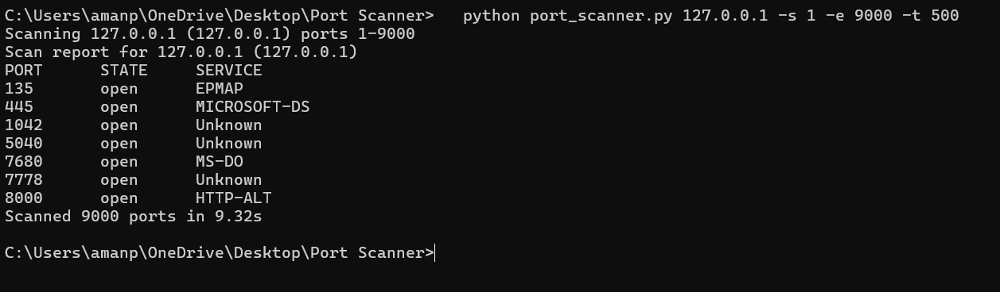

# Python Port Scanner

A simple multithreaded TCP port scanner built with Python's `socket` and `concurrent.futures` modules. It checks which ports are open on a target host and identifies the service commonly running on each.

> **Disclaimer:** For educational use only. Scan only systems you own or have explicit permission to test (e.g. `127.0.0.1`, `scanme.nmap.org`).

## Features

- TCP connect scan over a custom port range
- Multithreading for fast scans
- Service name detection for common ports (HTTP, SSH, MySQL, etc.)
- Hostname resolution and input validation
- Option to save the report to a file

## Requirements

- Python 3.8+ (no external libraries)

## Usage

```bash
python port_scanner.py 127.0.0.1
python port_scanner.py scanme.nmap.org -s 1 -e 1000 -t 200
python port_scanner.py 127.0.0.1 -s 1 -e 65535 -o report.txt
```

| Option            | Description                | Default  |
| ----------------- | -------------------------- | -------- |
| `host`            | Target hostname or IP      | required |
| `-s`, `--start`   | Start port                 | 1        |
| `-e`, `--end`     | End port                   | 1024     |
| `-t`, `--threads` | Number of threads          | 100      |
| `--timeout`       | Timeout per port (seconds) | 0.5      |
| `-o`, `--output`  | Save results to file       | none     |

## Sample Output



## How it works

For each port, the scanner tries to open a TCP connection using `connect_ex()`. A return value of 0 means the connection succeeded, so the port is open. A thread pool runs many of these checks in parallel.

## Future improvements

- UDP scanning
- Banner grabbing
- Export results as JSON/CSV
